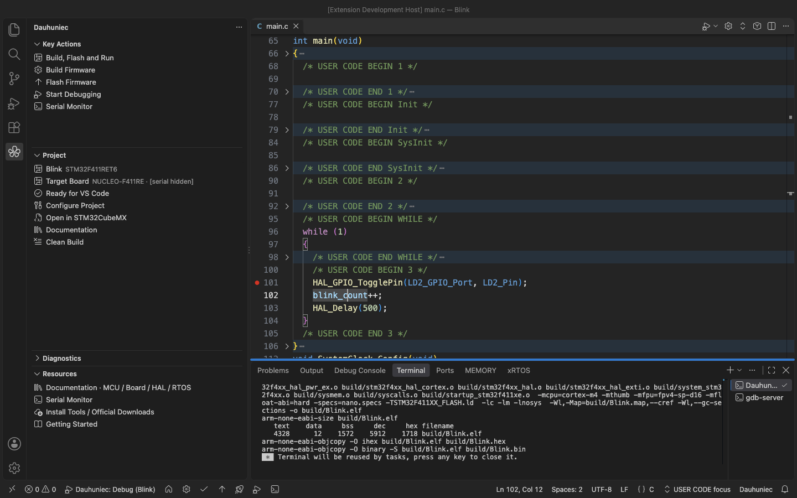
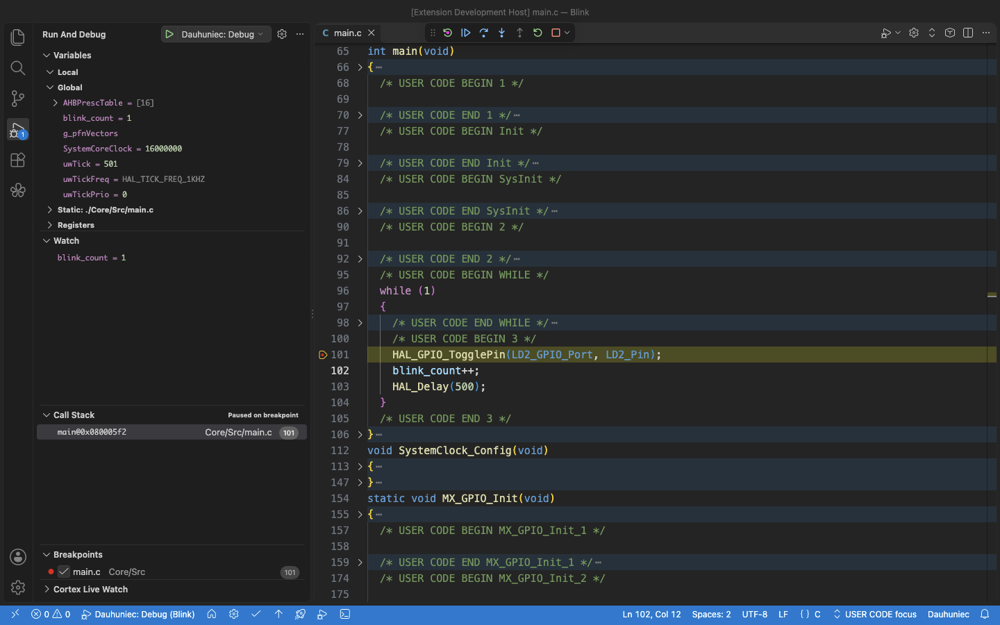
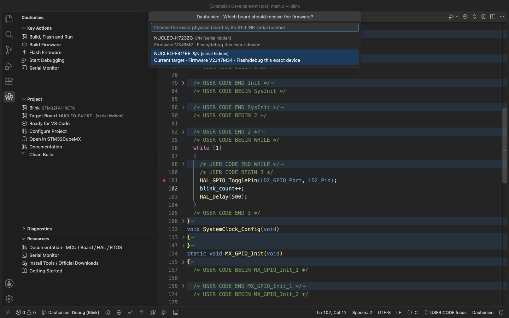
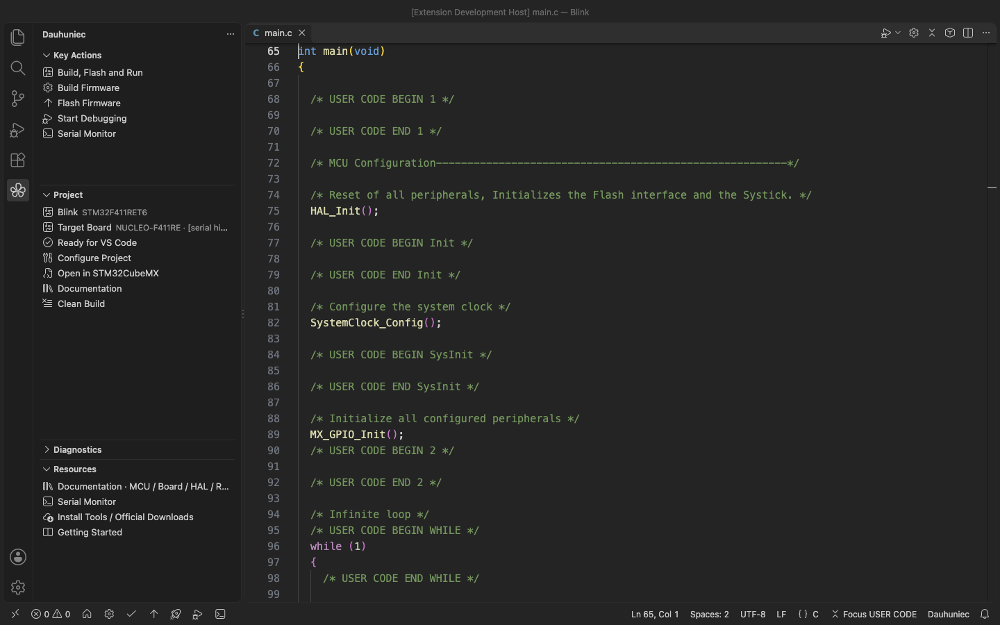
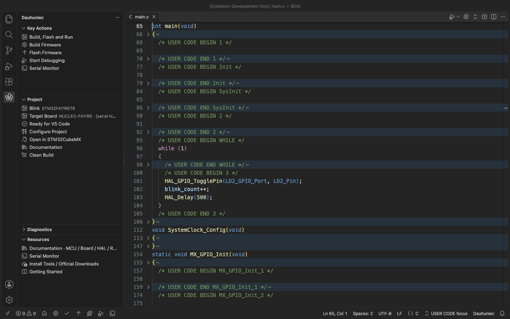
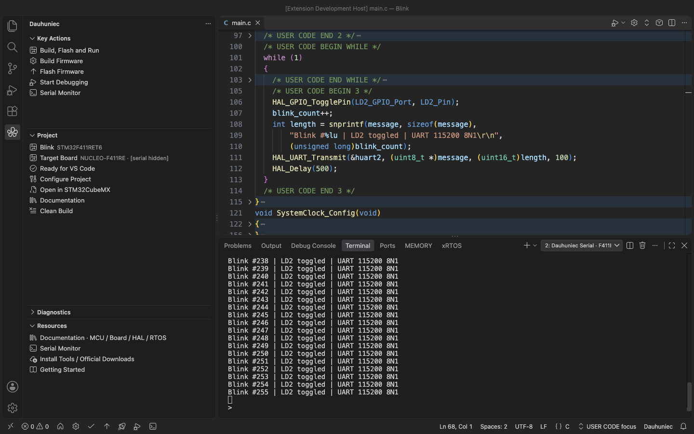
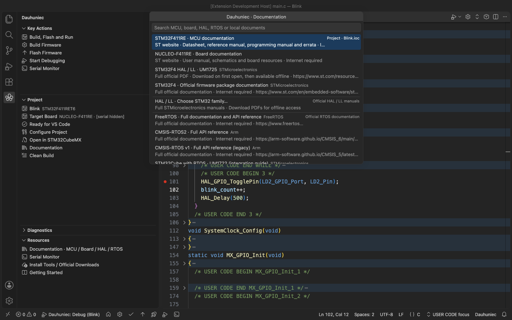

# Dauhuniec


**Build, flash and debug STM32CubeMX projects in VS Code.**

Keep CubeMX for pins, clocks and code generation. Use Dauhuniec for everyday
firmware development in VS Code: tool detection, builds, ST-LINK flashing,
Cortex-Debug integration and a serial monitor.

[Install from Marketplace](https://marketplace.visualstudio.com/items?itemName=dauhuniec.dauhuniec) ·
[Quick start](#quick-start) · [User guide](docs/guide.md) ·
[Changelog](extension/CHANGELOG.md) ·
[Report an issue](https://github.com/mikitabianko/Dauhuniec/issues)



## Features

- **Configure your project** with automatic discovery of CubeIDE tools and ready-to-use build, debug and IntelliSense settings.
- **Build, flash and debug** from the sidebar, status bar or Command Palette.
- **Choose your target** by ST-LINK serial number when several boards are connected.
- **Focus on USER CODE** by folding generated sections while keeping function context visible.
- **Monitor serial data** in the terminal with UTF-8/HEX display, configurable line endings and optional RX/TX logging.
- **Find MCU, board, HAL/LL and RTOS documentation**, cache official PDF manuals for offline reading and open local schematics.
- **Use the bundled `lon` CLI** for setup, builds, flashing and serial communication outside VS Code.

## Installation

Install **[Dauhuniec from the Visual Studio Marketplace](https://marketplace.visualstudio.com/items?itemName=dauhuniec.dauhuniec)**,
or search for **Dauhuniec** in VS Code's Extensions view. You can also run:

```sh
code --install-extension dauhuniec.dauhuniec
```

Requires **VS Code 1.95 or later**. C/C++ and Cortex-Debug are included as companion
extensions; install them manually if missing. Native CLI binaries are bundled for
Windows, macOS and Linux on x64 and ARM64. Extension users do not need Go, Python
or a separate Node.js installation.

For manual installation, download the `.vsix` from the latest
[GitHub Release](https://github.com/mikitabianko/Dauhuniec/releases/latest) and
choose **Extensions → … → Install from VSIX…**. One installer includes all six
CLI binaries.

## Required tools

| Tool | Purpose |
| --- | --- |
| [STM32CubeMX](https://www.st.com/en/development-tools/stm32cubemx.html) | Configure the MCU and generate a **Makefile** project. |
| [STM32CubeIDE](https://www.st.com/en/development-tools/stm32cubeide.html) | Supplies ARM GCC, GDB, ST-LINK GDB server and STM32CubeProgrammer. Dauhuniec uses these tools directly. |
| GNU Make | Builds the generated project; see platform setup below. |
| STM32 board with ST-LINK | Needed for flashing and debugging. An onboard probe and a data-capable USB cable are sufficient. |

- **Windows:** Make is detected inside CubeIDE. Install the [ST-LINK USB driver](https://www.st.com/en/development-tools/stsw-link009.html) as needed. See the [Windows setup guide](extension/docs/windows.md).
- **macOS:** install Command Line Tools with `xcode-select --install` to provide Make.
- **Linux:** install `make` through your package manager and CubeIDE's ST-LINK udev rules; ensure your user can access the device.

Official download links are also available through **Dauhuniec: Install Tools / Official Downloads**.

## Quick start

1. Create or open a project in **STM32CubeMX**. You can launch it with
   **Dauhuniec: Open in STM32CubeMX / Create Project**.
2. Select **Project Manager → Project → Toolchain / IDE → Makefile** and generate code.
3. Open the generated project folder in VS Code. Its root should contain one `.ioc` file and the `Makefile`.
4. Open **Dauhuniec** in the activity bar and choose **Configure Project**.
   If asked, select your CubeIDE installation or GNU Make executable.
5. Run **Dauhuniec: Build**.
6. Connect ST-LINK, select **Project → Target Board** if needed, then choose
   **Build, Flash and Run** or **Start Debugging**.



The example runs on a physical **NUCLEO-F411RE**. ST-LINK serial numbers are
hidden in the screenshots.

For F5 debugging, select **Dauhuniec: Debug** in Run and Debug. The status bar
also provides shortcuts for CubeMX, building, flashing, debugging and the serial monitor.

Setup adds local tools under `.dauhuniec/` and merges editor configuration into
`.vscode/`, backing up existing editor files. Firmware sources, the `.ioc`, linker
script and Makefile stay unchanged. Keep application code in CubeMX's `USER CODE`
sections when regenerating; clean and rebuild after changing the source/driver set.

## Select a target board

Open **Project → Target Board** to choose the board that receives firmware.
Dauhuniec remembers its ST-LINK serial number per project. The example shows
NUCLEO-F411RE selected while NUCLEO-H723ZG is also connected; serial numbers are
hidden in the image.



## Focus on USER CODE

Run **Dauhuniec: Focus on USER CODE** or use the editor title button to hide
generated sections. **Show Full File** restores the complete view. This changes
editor folding only; your source files and CubeMX regeneration stay unchanged.

The same `main.c` before and after focusing. Generated initialization and helper
code fold away; USER CODE blocks and their function context stay visible.

| Full file | Focus on USER CODE |
| --- | --- |
| [](extension/media/screenshots/user-code-full.png) | [](extension/media/screenshots/user-code-focus.png) |

## Serial monitor

Run **Dauhuniec: Open Serial Monitor**, choose your board's port and baud rate,
and read incoming data in VS Code's Terminal panel. Type a message and press Enter
to send it. Use `/hex` and `/text` to switch the receive display, `/log PATH` to
record RX/TX, and `/quit` or Ctrl+C to disconnect.



This example receives USART2 messages through the F411RE's ST-LINK virtual serial
port at **115200 baud, 8N1**. The port name is hidden. See the
[Serial Monitor guide](extension/README.md#serial-monitor) for console commands.

## Documentation

Open **Resources → Documentation · MCU / Board / HAL / RTOS** to find references
for the MCU and board in your `.ioc`, HAL/LL manuals and RTOS documentation.
Official PDF manuals are downloaded on demand and reused offline. Local manuals
and schematics appear in the same picker.



## Compatibility

The build workflow supports standard **single-core STM32 MCU Makefile exports**
with literal `TARGET` and `BUILD_DIR` assignments. CMake, IAR/EWARM,
CubeIDE-managed builds, multi-core and STM32MP projects are not automatically
converted. USER CODE focus also works independently of build setup.

| Platform | Validation status |
| --- | --- |
| Windows | Tested. See the [Windows setup guide](extension/docs/windows.md). |
| macOS | Tested; local validation includes Intel macOS. |
| Linux | Native binaries supplied; runtime and hardware verification still needed. |

Binaries are supplied for x64 and ARM64 on each platform. This availability does
not imply that every OS, architecture, board and probe combination has been tested.
On Windows ARM64, CubeIDE tools and USB drivers must also support your machine.

Local desktop development is the primary workflow. For SSH, WSL or containers,
tools and USB/serial devices must be accessible on the workspace host.

## CLI

The bundled native CLI is called **`lon`**, from Belarusian **лён-даўгунец**
(fibre flax), the source of the Dauhuniec name. After configuring a firmware
project, run its local copy from that project's root:

```sh
./.dauhuniec/lon doctor
./.dauhuniec/lon build
./.dauhuniec/lon serial-console --port /dev/cu.usbmodem144203 --baud 115200
```

On Windows, use `.\.dauhuniec\lon.exe` and a port such as `COM3`; Linux ports often
look like `/dev/ttyACM0`. Run `--help` for all commands. Adding `lon` to PATH is optional.
See the [CLI guide](docs/guide.md#cli-without-the-extension) for standalone setup.

## Help and contributing

- **Tools not found:** run **Dauhuniec: Check Environment**, select CubeIDE or Make and reconfigure. Reconfigure after moving the project or updating CubeIDE.
- **ST-LINK not found:** check the USB cable, driver/udev rules, other debuggers and **Target Board**.
- **Breakpoints do not match:** clean and rebuild, then restart debugging.
- **Serial port busy:** close other serial applications; exit Dauhuniec's console with `/quit` or Ctrl+C to release the port.

See the [extension overview](extension/README.md), [user guide](docs/guide.md)
and [documentation sources](extension/docs/SOURCES.md). When
[reporting an issue](https://github.com/mikitabianko/Dauhuniec/issues), include
your OS, tool versions and relevant output from **Dauhuniec: Show Logs**.

For source builds, tests and packaging, read [CONTRIBUTING.md](CONTRIBUTING.md).
Release automation is described in [release administration](docs/releasing.md).

## License

[MIT](LICENSE). [GO-LICENSE.txt](GO-LICENSE.txt) covers the Go runtime;
[THIRD-PARTY-NOTICES.txt](THIRD-PARTY-NOTICES.txt) lists dependency notices.
Official manuals remain subject to their publishers' terms.
